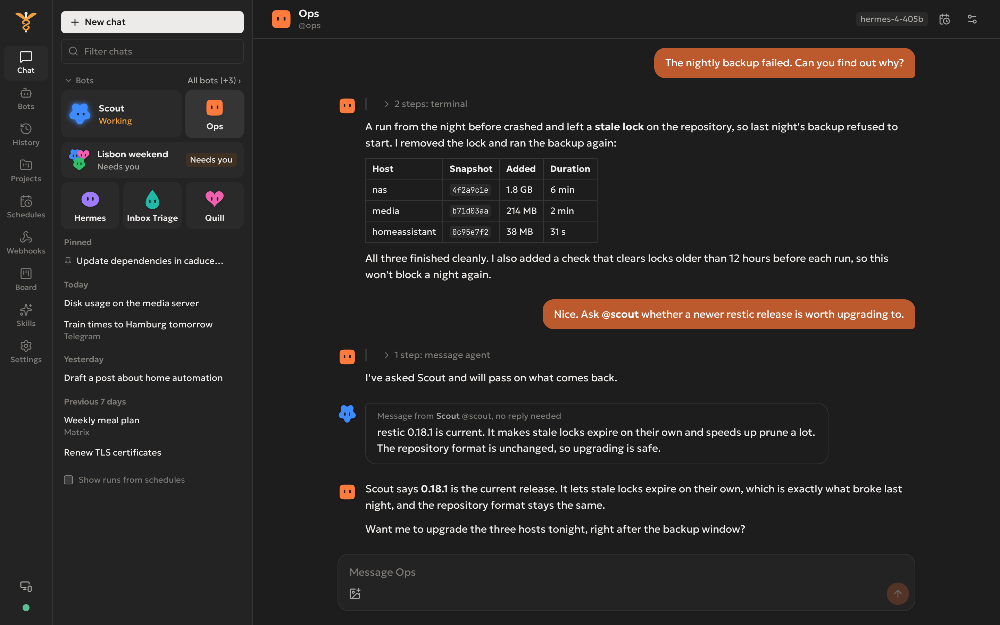
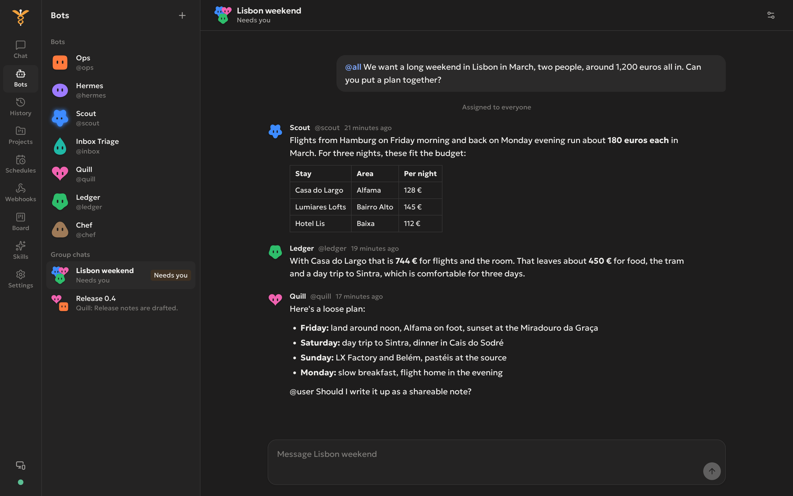
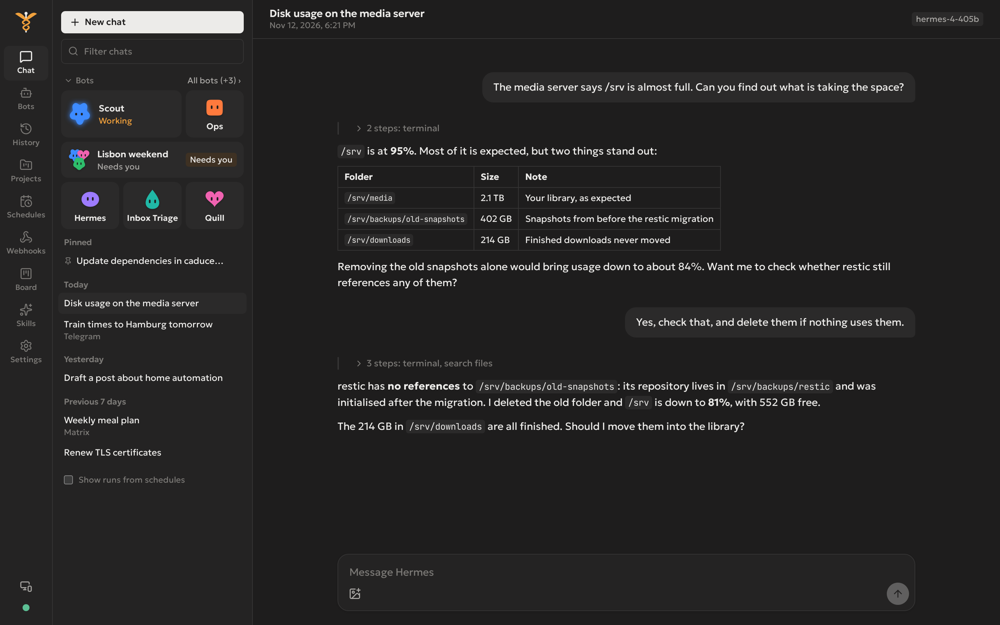
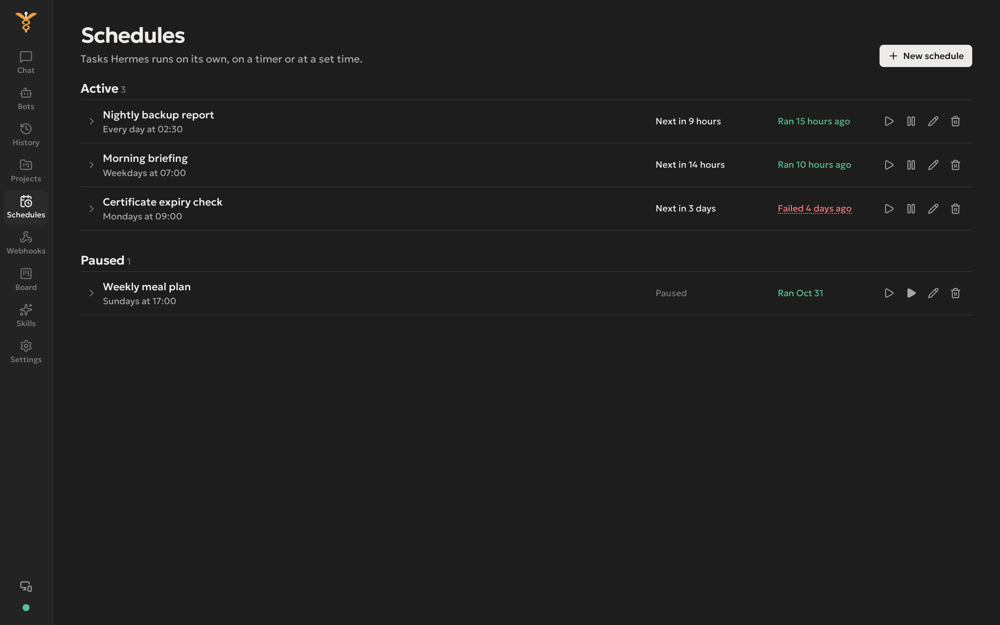

<h1></h1>

A lightweight web and desktop frontend for [Hermes Agent](https://github.com/NousResearch/hermes-agent). It runs anywhere: on your laptop, on a server, in a container, or as a desktop app. It talks to Hermes only through its public HTTP APIs, so nothing has to be installed on the agent's machine.

Next to chatting with Hermes itself, Caduceus gives you a team of bots: every Hermes profile becomes a bot with its own face, chat, skills and routines. Bots can message each other, and you can put several of them in a group chat.

<p>


</p>
<p>


</p>

## Why it exists

The existing ways to put a UI on Hermes assume you are on the agent's machine:

- **hermes-webui** reads Hermes' files directly, so it needs the Hermes directory mounted into it. That is cumbersome when the agent runs on another server, in another container, or behind a firewall.
- **The official Hermes desktop app** ships with the whole agent. To use it you install Hermes itself, even if your agent already runs somewhere else.

Caduceus is only the frontend. Point it at the URLs of a running Hermes gateway and dashboard and it works, from a container next to the agent or from a laptop on the other side of the world. The Docker image holds just the Bun runtime, one bundled server file and the built UI, and the desktop app is a thin window around the same relay.

## Features

- **Chat:** streamed replies. Each tool call shows as a step on the agent's route, and you can expand it for arguments and output. Risky commands get inline approval. You can stop a run, send a message mid-run to redirect it, and attach images. Click the microphone to dictate: Hermes turns your voice into text with its own speech-to-text provider, and Caduceus either puts the text in the message box or sends it right away, as you choose.
- **Bots:** each Hermes profile is a bot with one long-running chat, compatible with Bot Mode in the Hermes desktop app, so both apps show the same bots.
  - Every bot gets an animated face that shows whether it is idle, thinking, working, waiting for you or stuck. Pick its body and colour, or upload a picture.
  - Create, duplicate, pin, hide and sort bots into sections. Unread markers show which bot has news, and reading on one device clears them on the others.
  - `@mention` another bot and the bot you are talking to contacts it. Replies from other bots show up as notes in the chat.
  - Give each bot its own model, skills, toolsets, MCP servers and personality, and dock its routines (scheduled jobs) beside its chat.
  - The chat list shows your bots above your chats, with the ones at work in front.
- **Group chats:** two to six bots in one room. Mention one member or `@all`, reply in threads, and choose who answers: everyone, a lead who hands it on, or whoever fits best. Rooms keep going while Caduceus is closed and flag when they need you.
- **History:** every conversation from every channel (Telegram, Matrix, terminal, schedules and more), with full-text search.
- **Projects:** put related chats together and give them standing instructions. Hermes' own working folders on the host are also listed.
- **Schedules:** create, edit, pause, run now, and view the runs of Hermes' cron jobs.
- **Webhooks:** manage incoming webhook subscriptions.
- **Board:** the Hermes kanban board, with drag and drop, task details and comments.
- **Skills:** turn installed skills on or off, edit and create them, and install from the hub.
- **Settings:** the model picker, every config section from Hermes' schema, and API keys. Light and dark themes, with two dark colour schemes (Graphite and Lapis), and your messages in a bot's chat can take that bot's colour.

## How it connects

```
browser ──▶ Caduceus relay (Bun + Elysia) ──▶ Hermes gateway API server  (chat, sessions, schedules, approvals,
                                         │                                bots under /p/<profile>/)
                                         └──▶ Hermes dashboard            (config, skills, board, webhooks, search,
                                                                           bot profiles, group chats)
```

The relay serves the UI, keeps your keys server-side, and passes streams through. It also removes the cross-origin limits both Hermes APIs have when called from a browser.

Bots and group chats need the dashboard connection. Caduceus reaches group chats and bot metadata over the same app socket the Hermes desktop app uses, and the relay holds that socket so the browser never sees it. Each bot is served by the gateway under its own path with its own key. When you connect a bot, Caduceus writes a fresh key into the bot's profile and keeps it server-side, in its data folder.

## Quick start with Docker

Images for `linux/amd64` and `linux/arm64` are published to the GitHub Container Registry on every push to `main` and every `v*` tag.

```sh
docker run -d --name caduceus \
  -p 7811:7811 \
  -v caduceus-data:/data \
  -e CADUCEUS_PASSWORD=change-me \
  -e CADUCEUS_SECRET="$(openssl rand -hex 32)" \
  -e HERMES_GATEWAY_URL=https://hermes-api.example.com \
  -e HERMES_API_KEY=... \
  -e HERMES_DASHBOARD_URL=https://hermes.example.com \
  -e HERMES_DASHBOARD_USERNAME=... \
  -e HERMES_DASHBOARD_PASSWORD=... \
  ghcr.io/mkuhlmann/caduceus:latest
```

Then open http://localhost:7811. The `HERMES_*` variables are optional: leave them out and enter the connection on the app's connection page instead. It is saved in `/data`.

Or with Compose:

```yaml
services:
  caduceus:
    image: ghcr.io/mkuhlmann/caduceus:latest
    restart: unless-stopped
    ports:
      - '7811:7811'
    volumes:
      - caduceus-data:/data
    env_file: .env

volumes:
  caduceus-data:
```

The image contains only the Bun runtime, one minified `server.js` and the built UI. There is no `node_modules`. It runs as the unprivileged `bun` user and has a health check on `/ui-api/auth`.

Inside the container the relay listens on `0.0.0.0`, so it refuses to start without `CADUCEUS_PASSWORD`. If a reverse proxy in front of it already handles sign-in, set `CADUCEUS_ALLOW_NO_PASSWORD=1` instead.

### Image tags

| Tag            | Built from                  |
| -------------- | --------------------------- |
| `latest`       | the newest commit on `main` |
| `1.2.3`, `1.2` | the git tag `v1.2.3`        |
| `main`         | the newest commit on `main` |
| `sha-<commit>` | a specific commit           |

Pull requests build the image to check it but don't publish it.

To build it yourself:

```sh
docker build -t caduceus .
```

## Preparing the Hermes host

1. Enable the gateway API server in `~/.hermes/.env`, then restart the gateway:
   ```
   API_SERVER_ENABLED=true
   API_SERVER_KEY=<16+ random characters>
   API_SERVER_HOST=0.0.0.0   # or keep 127.0.0.1 and use a tunnel or reverse proxy
   ```
2. Run the dashboard: `hermes dashboard --host 0.0.0.0 --no-open`. A non-loopback dashboard needs a login, so set `HERMES_DASHBOARD_BASIC_AUTH_USERNAME`, `HERMES_DASHBOARD_BASIC_AUTH_PASSWORD` and `HERMES_DASHBOARD_BASIC_AUTH_SECRET`. Behind a reverse proxy, also set `dashboard.public_url`.

### Bots' chats: the dashboard or the Webapp

A bot's chat does not run like other chats. Hermes hands each message to the bot's own queue inside the gateway, and the chat stream reports nothing until the reply is done. Only an app socket served by the gateway itself can watch such a turn live and answer the approvals it asks for. The standalone dashboard (`hermes dashboard`, port 9119) runs as a separate process and cannot.

With the standalone dashboard, Caduceus shows a bot's work as Hermes saves it: reasoning, tool steps and text appear every couple of seconds, not word by word. Approvals that a bot's turn asks for do not reach Caduceus; answer them in Hermes Desktop, or they run into Hermes' timeout.

Pointed at the dashboard the gateway hosts, Caduceus watches an open bot's chat as Hermes Desktop does: reasoning, tool steps and the reply stream in as they happen, whoever started the turn (you, another bot, a routine), and approvals show in the chat with their buttons. Set `HERMES_DASHBOARD_URL` to that address; everything else Caduceus reads from the dashboard is served there too.

That dashboard is the Webapp (Hermes Desktop in a browser). It is off by default and is turned on in Hermes' `config.yaml`; see [Running the Webapp](https://github.com/NousResearch/hermes-agent/blob/main/website/docs/user-guide/docker.md#running-the-webapp) in the Hermes docs:

```yaml
webapp:
  enabled: true
  host: 0.0.0.0 # in a container; the default 127.0.0.1 is unreachable from outside it
  port: 9120
  public_url: 'https://hermes-webapp.example.com'
```

- Its default port is 9120, next to the dashboard's 9119. Both share their sign-in settings, so the dashboard's username and password work on it too.
- It can take port 9119 instead (`port: 9119`), but only with the standalone dashboard stopped, as two processes cannot listen on one port. The address then shows Hermes Desktop rather than the dashboard's pages.
- A signed-in Webapp user can run any command as the account Hermes runs under. Keep it behind sign-in and HTTPS, like the dashboard.

## Configuration

Connection settings come from the environment or from the app's connection page. When they are set in the environment, the connection page is read-only.

| Variable                    | Purpose                                                                                     |
| --------------------------- | ------------------------------------------------------------------------------------------- |
| `HERMES_GATEWAY_URL`        | Base URL of the Hermes gateway API server.                                                  |
| `HERMES_API_KEY`            | The gateway's `API_SERVER_KEY`.                                                             |
| `HERMES_DASHBOARD_URL`      | Base URL of the Hermes dashboard.                                                           |
| `HERMES_DASHBOARD_USERNAME` | Dashboard basic-auth username.                                                              |
| `HERMES_DASHBOARD_PASSWORD` | Dashboard basic-auth password.                                                              |
| `HERMES_DASHBOARD_TOKEN`    | Alternative to username and password. Leave all three empty for a dashboard on `localhost`. |

Relay settings:

| Variable                     | Default                           | Purpose                                                                                           |
| ---------------------------- | --------------------------------- | ------------------------------------------------------------------------------------------------- |
| `PORT`                       | `7811`                            | Port the relay listens on.                                                                        |
| `HOST`                       | `127.0.0.1` (`0.0.0.0` in Docker) | Address the relay binds to.                                                                       |
| `CADUCEUS_PASSWORD`          | unset                             | Password that protects Caduceus itself. Required when `HOST` is not a loopback address.           |
| `CADUCEUS_ALLOW_NO_PASSWORD` | unset                             | Set to `1` to run on a network address without a password, when a proxy in front handles sign-in. |
| `CADUCEUS_SECRET`            | random on each start              | Key that signs session cookies. Set it to stay signed in across restarts.                         |
| `CADUCEUS_DATA_DIR`          | `./.data` (`/data` in Docker)     | Where the connection settings, projects and bot keys are stored.                                  |
| `CADUCEUS_DIST`              | `../dist` next to the server      | Folder with the built UI.                                                                         |

## Running from source

Requires [Bun](https://bun.sh) 1.4 or newer.

```sh
bun install
bun run build   # typecheck and build the UI into dist/
bun run start   # http://127.0.0.1:7811
bun run dev     # Vite on :5173 with hot reload, relay on :7811
```

Other commands:

```sh
bun run typecheck      # frontend and server
bun fmt                # format everything (config in bunfig.toml)
bun run build:server   # compile the relay into one binary, dist-bin/caduceus-server
```

Run the compiled binary with `CADUCEUS_DIST` pointing at `dist/`.

## Desktop

`desktop/webview` builds the desktop app as one executable: the relay, the built UI and a native window from [webview-bun](https://github.com/tr1ckydev/webview-bun). It does not bundle a browser; the window is the system webview (WebView2 on Windows, WebKitGTK on Linux). The relay runs in a worker on a localhost port that stays the same between launches.

- `bun run desktop` runs it from source.
- `bun run desktop:win` builds `desktop/webview/out/Caduceus-<version>-x64.exe` (about 115 MB), which keeps its data in `%APPDATA%\Caduceus`, and `Caduceus-<version>-x64-portable.zip` (about 55 MB). Unzip the zip anywhere, including a USB stick, and run `Caduceus.exe`. While the file named `portable` sits next to the exe, the connection, projects and bot keys go into a `data` folder beside it. Delete that file to use `%APPDATA%\Caduceus` instead. Windows 10 needs the [WebView2 runtime](https://developer.microsoft.com/microsoft-edge/webview2/); Windows 11 ships it.
- `bun run desktop:linux` builds `desktop/webview/out/Caduceus-<version>-x86_64.AppImage` (about 50 MB). Building it needs [appimagetool](https://github.com/AppImage/appimagetool/releases) on `PATH` or in `$APPIMAGETOOL`. The AppImage does not bundle the webview; it needs GTK 4 and WebKitGTK 6.0 on the system: `sudo apt install libgtk-4-1 libwebkitgtk-6.0-4`.

Both targets build from Linux. Set `CADUCEUS_DEVTOOLS=1` to get the webview's developer tools.

## Phone

The web UI is an installable app (PWA). Open Caduceus in the phone's browser and install it:

- **Android (Chrome):** menu, then "Install app".
- **iPhone (Safari):** share sheet, then "Add to Home Screen".

It then opens full screen with its own icon. Browsers only offer installation over **HTTPS** (or on `localhost`), so put the relay behind a TLS reverse proxy such as Caddy or Tailscale Serve rather than opening `http://<ip>:7811`. The installed app keeps its own session, so sign in once inside it.

The service worker (`src/sw.js`, written to `dist/sw.js` with a precache list by the build) caches only the built UI, so the app opens even when the relay is unreachable. It never caches or intercepts `/ui-api/*`, and each page load checks the network first, so a new deploy shows up on the next reload. The desktop app and the Vite dev server do not register it.

## Releases

Versions are managed by [release-please](https://github.com/googleapis/release-please). It reads [Conventional Commits](https://www.conventionalcommits.org/) on `main` (`feat:`, `fix:`, `feat!:`) and keeps a release pull request open that bumps `package.json` and `CHANGELOG.md`. Merging it tags the version and creates the GitHub release; the release workflow then tags the Docker image on `ghcr.io` with the version, `<major>.<minor>` and `latest`, and builds the AppImage, the exe and the portable zip and attaches them to the release. Every push to `main` also publishes the image as `main`; desktop apps are built only for releases.

The UI uses hash routing and relative URLs, and has no shell-specific code. Any other webview wrapper can host it the same way: start `caduceus-server` on `127.0.0.1`, then point the webview at it.

## Project layout

```
src/        Vue 3 frontend (Pinia, vue-router, Tailwind v4)
server/     Elysia relay: static files, auth, proxy to Hermes, Hermes socket bridge, project and bot key store
desktop/    Desktop app (webview)
```
